# Secure Web Hosting on AWS: EC2 + Application Load Balancer + Route 53 + ACM (HTTPS)

## Overview

This project shows how to host a website on AWS and serve it securely over HTTPS using a custom domain name.

A web server runs on an **EC2 instance**, sits behind an **Application Load Balancer (ALB)**, is reachable through a domain managed in **Route 53**, and is secured with a free SSL/TLS certificate from **AWS Certificate Manager (ACM)**.

---

## Architecture

```
User (browser)
     │  https://www.example.com
     ▼
Route 53 (Public Hosted Zone)
  A record (Alias) ──► Application Load Balancer
                              │  HTTPS :443 (ACM certificate)
                              │  HTTP  :80  ──► redirect to HTTPS
                              ▼
                       Target Group
                              │
                              ▼
                    EC2 instance (Nginx/Apache web server)
```

---

## Services Used

| Service | Purpose |
|---|---|
| Amazon EC2 | Hosts the web server |
| Elastic Load Balancing (ALB) | Distributes incoming traffic and terminates HTTPS |
| Amazon Route 53 | DNS: hosted zone and Alias A record |
| AWS Certificate Manager (ACM) | Issues and manages the SSL/TLS certificate |
| Security Groups | Control inbound and outbound traffic |

---

## Prerequisites

- An AWS account
- A registered domain name (from Route 53 or any registrar)
- Basic knowledge of EC2 and networking
- A region selected for all resources (the ACM certificate must be in the **same region as the load balancer**)

> Replace `example.com` throughout this guide with your own domain.

---

## Step 1: Set Up an EC2 Instance as a Web Server

### 1.1 Launch the instance

1. Open **EC2 → Instances → Launch instances**.
2. Name: `web-server`.
3. AMI: **Amazon Linux 2023** (or Ubuntu).
4. Instance type: `t2.micro` / `t3.micro` (Free Tier eligible).
5. Key pair: create or select an existing one.
6. Network settings: choose a VPC and a public subnet, and enable **Auto-assign public IP**.
7. Security group `web-server-sg`: allow **HTTP (80)** (the source will be restricted to the load balancer later) and **SSH (22)** from your IP.

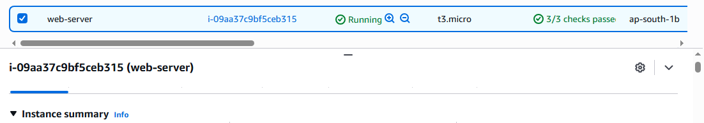

### 1.2 Install and start the web server

Connect to the instance over SSH, then run:

**Amazon Linux**
```bash
sudo yum update -y
sudo yum install -y nginx
sudo systemctl enable --now nginx
```

**Ubuntu**
```bash
sudo apt update -y
sudo apt install -y nginx
sudo systemctl enable --now nginx
```

### 1.3 Add a test page

```bash
echo "<h1>Hello from my AWS Web Server</h1>" | sudo tee /usr/share/nginx/html/index.html
```
(On Ubuntu the path is `/var/www/html/index.html`.)

### 1.4 Verify

Open `http://<EC2-public-IP>` in a browser. The test page should appear.

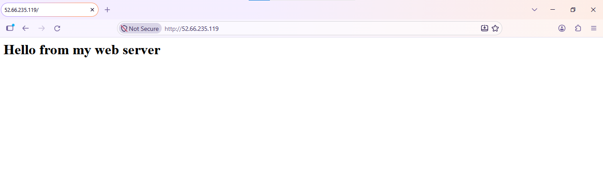

---

## Step 2: Create and Connect a Load Balancer

### 2.1 Create a target group

1. Go to **EC2 → Target Groups → Create target group**.
2. Target type: **Instances**.
3. Name: `web-tg`, Protocol: **HTTP**, Port: **80**.
4. Health check path: `/`.
5. Register the `web-server` instance as a target and create the group.

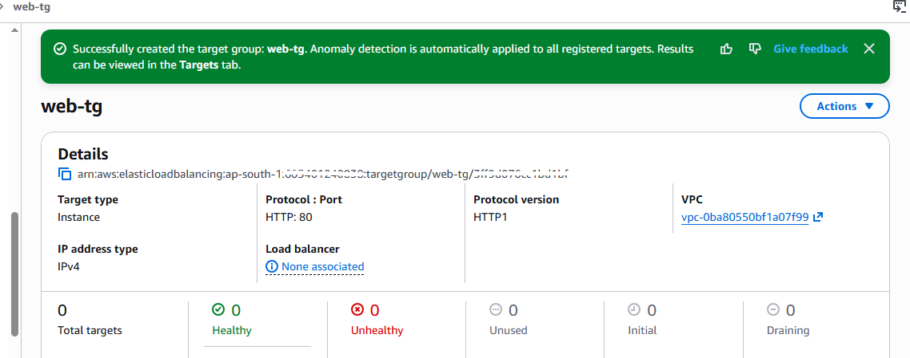

### 2.2 Create the Application Load Balancer

1. Go to **EC2 → Load Balancers → Create load balancer → Application Load Balancer**.
2. Name: `web-alb`, Scheme: **Internet-facing**, IP type: **IPv4**.
3. Network mapping: select the VPC and **at least two Availability Zones** (public subnets).
4. Security group `alb-sg`: allow **HTTP (80)** and **HTTPS (443)** from `0.0.0.0/0`.
5. Listener: **HTTP : 80**, forward to `web-tg` (HTTPS will be added in Step 4).
6. Create the load balancer.

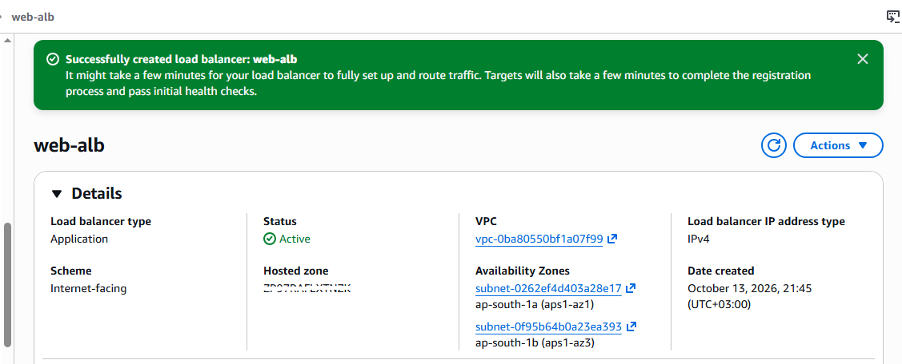

### 2.3 Lock down the web server security group

Edit `web-server-sg` so that HTTP (80) is allowed **only from `alb-sg`**. This ensures traffic reaches the instance only through the load balancer.

### 2.4 Verify

Wait until the target shows **healthy** in the target group, then open the ALB's **DNS name** in a browser.

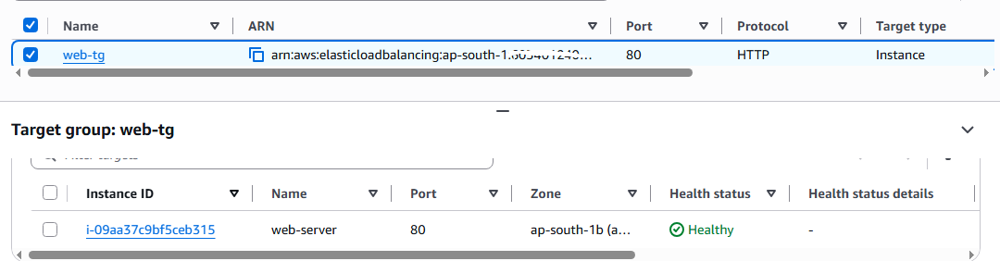
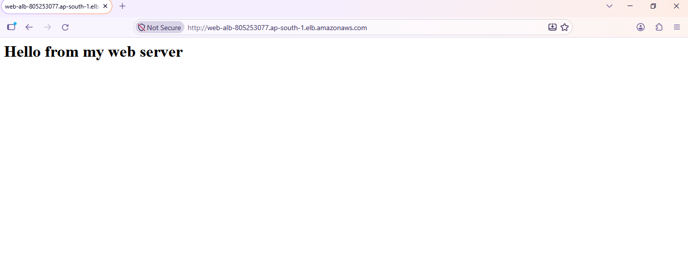

---

## Step 3: Create a Public Hosted Zone in Route 53 and an Alias A Record

### 3.1 Create the hosted zone

1. Open **Route 53 → Hosted zones → Create hosted zone**.
2. Domain name: `example.com`.
3. Type: **Public hosted zone**.
4. Create. Route 53 automatically adds **NS** and **SOA** records.

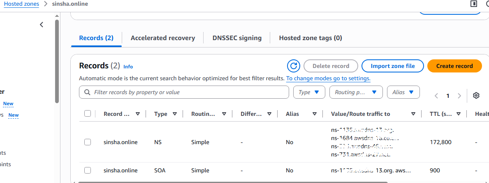

### 3.2 Point the domain to Route 53

- **Domain registered in Route 53:** it is usually configured automatically, but confirm that the domain's name servers match the hosted zone's NS records.
- **Domain registered elsewhere:** copy the four NS values from the hosted zone and set them as custom name servers at your registrar.

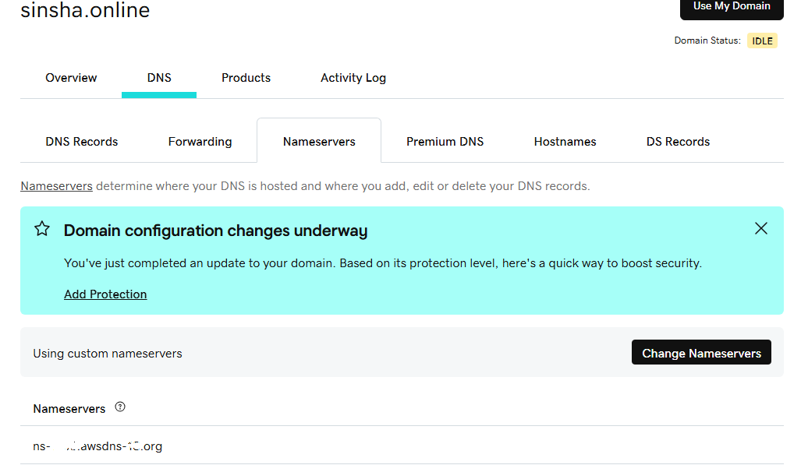

### 3.3 Create the A record (Alias to the load balancer)

1. In the hosted zone, choose **Create record**.
2. Record name: leave blank for the root domain (or enter `www`).
3. Record type: **A**.
4. Enable **Alias**.
5. Route traffic to: **Alias to Application and Classic Load Balancer** → select your **region** → select `web-alb`.
6. Routing policy: **Simple routing**. Enable **Evaluate target health**.
7. Create the record.

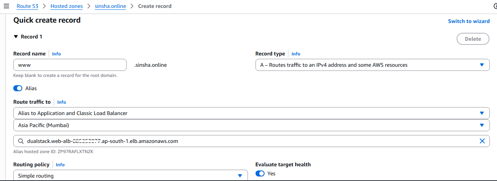

### 3.4 Verify

After DNS propagates, open `http://example.com`. The site should load through the load balancer.

```bash
nslookup example.com
```

---

## Step 4: Configure ACM and Enable HTTPS

### 4.1 Request a public certificate

1. Open **AWS Certificate Manager** (make sure you are in the **same region as the ALB**).
2. Choose **Request a certificate → Request a public certificate**.
3. Domain names: `example.com` and `*.example.com` (or the specific `www.example.com`).
4. Validation method: **DNS validation**.
5. Key algorithm: RSA 2048 (default).
6. Request the certificate.

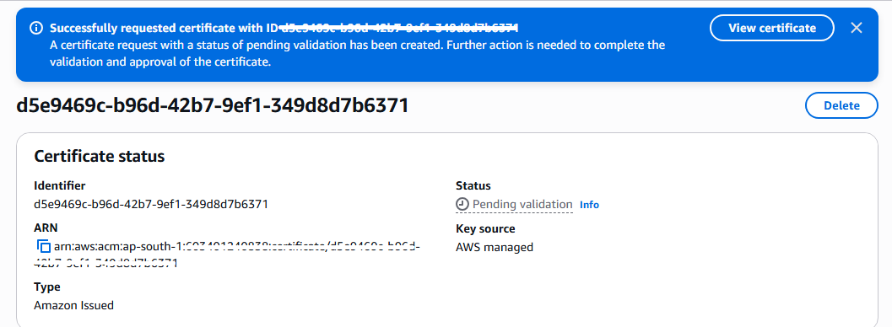

### 4.2 Validate through Route 53

1. Open the certificate details (status: **Pending validation**).
2. Choose **Create records in Route 53** and confirm. ACM adds the required CNAME validation records to the hosted zone automatically.
3. Wait a few minutes until the status becomes **Issued**.

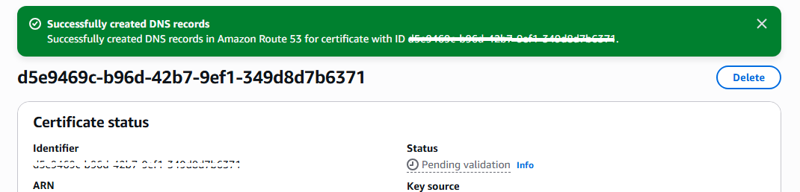
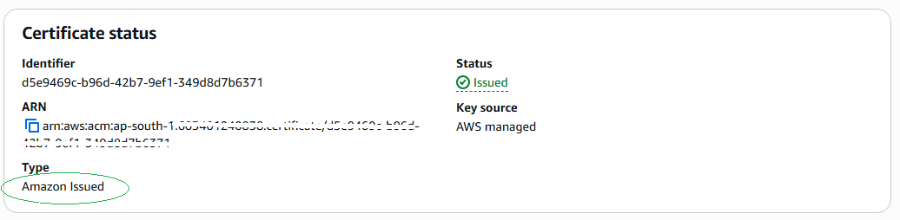

### 4.3 Add an HTTPS listener to the load balancer

1. Go to **EC2 → Load Balancers → web-alb → Listeners and rules → Add listener**.
2. Protocol: **HTTPS**, Port: **443**.
3. Default action: **Forward to** `web-tg`.
4. Security policy: use the default recommended policy.
5. Default SSL/TLS certificate: **From ACM** → select the issued certificate.
6. Add the listener.

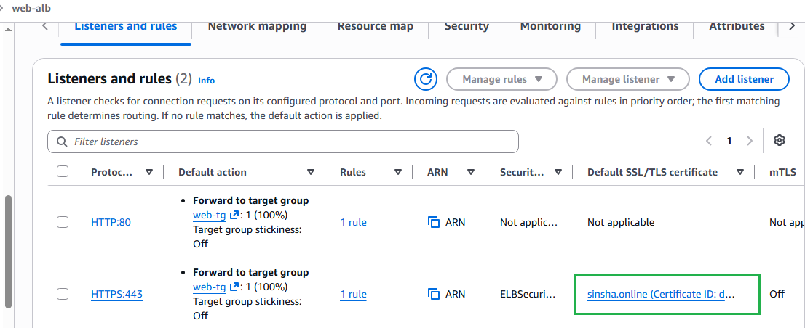

### 4.4 Redirect HTTP to HTTPS

1. Open the existing **HTTP : 80** listener and choose **Edit**.
2. Change the default action to **Redirect to URL** → Protocol **HTTPS**, Port **443**, Status code **301 (Permanently moved)**.
3. Save the changes.
4. Make sure `alb-sg` allows inbound **HTTPS (443)** from `0.0.0.0/0`.

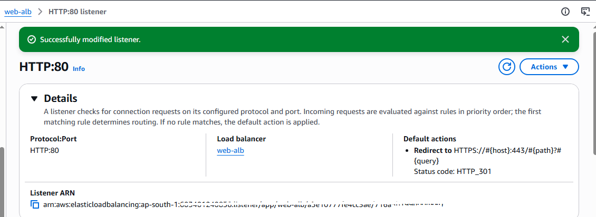

---

## Final Verification

1. Open `https://example.com` in a browser. The page loads and the **padlock** icon is shown.
2. Open `http://example.com`. It should automatically redirect to `https://example.com`.
3. Check the certificate details in the browser (issued by **Amazon**, valid for your domain).

```bash
curl -I http://example.com     # expect 301 redirect to https
curl -I https://example.com    # expect 200 OK
```

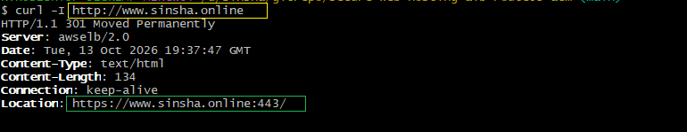

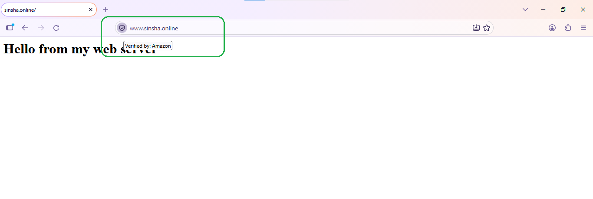

---

## Troubleshooting

| Problem | Likely cause and fix |
|---|---|
| Target shows **unhealthy** | Web server not running, wrong health check path, or `web-server-sg` does not allow traffic from `alb-sg` |
| Domain does not resolve | Name servers at the registrar do not match the hosted zone; wait for DNS propagation |
| Certificate stuck in **Pending validation** | CNAME validation records missing in the hosted zone, or wrong name servers |
| Certificate not visible when adding the HTTPS listener | Certificate was requested in a different region than the ALB |
| HTTPS times out | `alb-sg` does not allow inbound port 443 |
| Browser shows a certificate warning | The domain you are visiting is not covered by the certificate |

---

## Cleanup

To avoid unnecessary charges, delete the resources in the order below. 

1. Route 53 records (Alias A record, ACM validation CNAMEs, then the hosted zone)
2. Load balancer
3. Target group
4. EC2 instance
5. ACM certificate
6. Security groups (web-server-sg first, then alb-sg)

---

## Key Learnings

- An **Alias record** lets Route 53 point a domain (even the root domain) directly to an AWS resource such as an ALB, with no extra cost for queries.
- **ACM public certificates are free** and renew automatically when validated through DNS.
- **TLS termination at the load balancer** keeps certificate management out of the web server.
- Restricting the instance security group to the ALB security group keeps the server off the public internet.
- ACM certificates must be in the **same region** as the load balancer using them.

---

## Conclusion

The website now runs on an EC2 web server behind an Application Load Balancer, is reachable through a custom domain managed by Route 53, and is served securely over HTTPS with an ACM certificate, with HTTP traffic automatically redirected to HTTPS.

---
 
## Author

**Sinsha C**
 
## Connect

If you're on a similar DevOps learning journey, feel free to connect or follow along:

[](https://github.com/sinsha-c)
[](https://linkedin.com/in/sinshac)